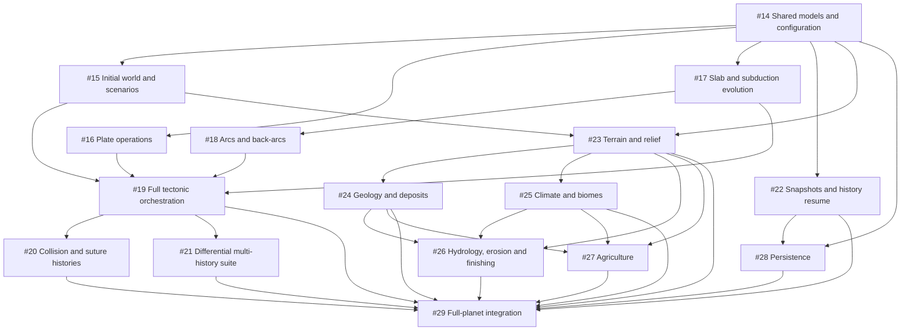

# Porting issue roadmap

This document explains how the remaining Orogen 3.0.1 porting work is split across GitHub issues, which tasks block other tasks, and which work can proceed concurrently.

It is a coordination document, not a claim that the listed work has already been implemented. The implementation status remains tracked in [`PORTING_STATUS.md`](PORTING_STATUS.md).

- **Repository:** [Thomas-GAUTRON2004/Orogen_python](https://github.com/Thomas-GAUTRON2004/Orogen_python)
- **Porting branch:** `port/v3.0.1`
- **Upstream reference:** [`raguilar011095/planet_heightmap_generation`](https://github.com/raguilar011095/planet_heightmap_generation), tag `v3.0.1`, commit `ed466f9db71292e912d8d0160e689a67a994f2d9`
- **Umbrella tracking:** [PR #1 — progressive Orogen 3.0.1 port](https://github.com/Thomas-GAUTRON2004/Orogen_python/pull/1)

## 1. How to read the issue graph

The issue set is designed as a dependency graph rather than a single, strictly sequential checklist.

Each implementation issue includes three relationship fields:

- **Blocking prerequisites** are the minimum upstream tasks that must be completed before the issue can be considered fully integrated and accepted.
- **Unblocks** lists the follow-on issues that can use the completed work.
- **Can proceed in parallel with** lists work that can be developed at the same time, provided shared interfaces and test fixtures are agreed.

A parallel relationship does **not** mean that the tasks have no integration boundary. It means that implementation can proceed independently using explicit data contracts, deterministic fixtures, and isolated tests. Integration and end-to-end validation still happen when the relevant prerequisites are available.

The issue bodies are the operational source of truth for each issue's acceptance criteria and current relationships. Update this document when the graph changes.

## 2. Issue catalogue

### Foundations and tectonics

| Issue | Work package | Blocking prerequisites | Main outputs |
|---|---|---|---|
| [#14](https://github.com/Thomas-GAUTRON2004/Orogen_python/issues/14) | Complete shared configuration and data models | None | Stable configuration groups, shared models, validation rules |
| [#15](https://github.com/Thomas-GAUTRON2004/Orogen_python/issues/15) | Initial-world generator and scenario builders | #14 | Reproducible initial tectonic worlds and scenario fixtures |
| [#16](https://github.com/Thomas-GAUTRON2004/Orogen_python/issues/16) | Plate operations and ocean-plate lifecycle | #14 | Remaining plate transfers and ocean-plate evolution |
| [#17](https://github.com/Thomas-GAUTRON2004/Orogen_python/issues/17) | Slab and subduction evolution | #14 | Slab lifecycle, subduction dynamics and force coupling |
| [#18](https://github.com/Thomas-GAUTRON2004/Orogen_python/issues/18) | Arc, back-arc and maturation scheduling | #17 | Arc/back-arc lifecycle and V2 scheduling |
| [#19](https://github.com/Thomas-GAUTRON2004/Orogen_python/issues/19) | Complete `simulate.js` tectonic orchestration | #15, #16, #17, #18 | Integrated tectonic stage order, cadence and topology updates |

### Tectonic validation and simulation history

| Issue | Work package | Blocking prerequisites | Main outputs |
|---|---|---|---|
| [#20](https://github.com/Thomas-GAUTRON2004/Orogen_python/issues/20) | Integrated collision–suture and orogenic-belt histories | #19 | Real-stepper collision, suture welding and belt validation |
| [#21](https://github.com/Thomas-GAUTRON2004/Orogen_python/issues/21) | Multi-history JavaScript/Python differential suite | #19 | Versioned fixtures and automated multi-step comparisons |
| [#22](https://github.com/Thomas-GAUTRON2004/Orogen_python/issues/22) | Snapshots and history resumption | #14 | Complete state snapshots and deterministic resumption |

### Planetary pipelines and final integration

| Issue | Work package | Blocking prerequisites | Main outputs |
|---|---|---|---|
| [#23](https://github.com/Thomas-GAUTRON2004/Orogen_python/issues/23) | Terrain and relief pipeline | #14, #15 | Terrain and relief fields derived from an initial world |
| [#24](https://github.com/Thomas-GAUTRON2004/Orogen_python/issues/24) | Geology, lithology and deposits | #23 | Geological states and deposition processes |
| [#25](https://github.com/Thomas-GAUTRON2004/Orogen_python/issues/25) | Climate, temperature, precipitation and biomes | #23 | Climate fields and biome classification |
| [#26](https://github.com/Thomas-GAUTRON2004/Orogen_python/issues/26) | Hydrology, erosion, ice and finishing | #23, #24, #25 | Surface finishing pipeline |
| [#27](https://github.com/Thomas-GAUTRON2004/Orogen_python/issues/27) | Agriculture systems | #23, #24, #25 | Agricultural outputs and rules |
| [#28](https://github.com/Thomas-GAUTRON2004/Orogen_python/issues/28) | Save/load and archive formats | #14, #22 | Persistent world and history formats |
| [#29](https://github.com/Thomas-GAUTRON2004/Orogen_python/issues/29) | Full-planet generation and global compatibility | #19, #20, #21, #22, #23, #24, #25, #26, #27, #28 | End-to-end generation and global compatibility evidence |

## 3. Dependency graph

Arrows indicate blocking dependencies: the source issue must be completed before the destination issue's dependent integration/acceptance work can be completed.

## 4. Recommended parallel work streams

The graph intentionally creates several work streams after the shared model contract (#14) is stable.

### Stream A — tectonic mechanics

1. Start #15, #16, #17 and #22 as separate work packages.
2. #18 follows the slab/subduction work in #17.
3. #19 integrates the initial-world, plate, slab and arc/back-arc work from #15–#18.
4. #20 and #21 then validate the integrated stepper from different angles.

The issue boundaries allow plate operations, slab dynamics and snapshot structures to be developed independently. Agree on shared contracts early, especially plate identity, crust ownership, event records, topology invalidation and world reconstruction.

### Stream B — terrain and planetary science

1. Start #23 once #14 and #15 provide stable world and input-state contracts.
2. Start #24 and #25 in parallel once #23 exposes stable terrain fields.
3. Develop #26 and #27 in parallel after the terrain, geology and climate interfaces are available.
4. Validate the combined outputs in #29.

The terrain implementation does not need to wait for the complete tectonic orchestration (#19). It can use deterministic world fixtures and a documented tectonic-state contract. Full coupling is validated later.

Geology (#24) and climate (#25) are independent branches after terrain. They should agree on shared field names, units, coordinate conventions and missing-data semantics, but neither needs to block the other's implementation.

Finishing (#26) and agriculture (#27) can also proceed as separate work packages after their common inputs are stable. Any specific finishing output required by agriculture should be documented as a narrow interface dependency rather than making all of #27 wait for all of #26.

### Stream C — snapshots and persistence

1. Develop #22 after #14 defines the shared state models.
2. Develop #28 after #22 defines the snapshot payload and restoration contract.
3. Both can progress alongside tectonic validation and planetary pipeline work.
4. Verify save/load and interrupted/resumed execution in #29.

### Stream D — validation

#20 and #21 share the integrated tectonic stepper delivered through #19, but have different purposes:

- #20 verifies physical and state transitions in collision, sea closure, suture welding, plate merging and orogenic belts.
- #21 establishes repeatable JavaScript/Python comparisons over multiple seeds, resolutions and time steps.

They can be implemented concurrently. Where possible, #20 should provide focused scenario fixtures that #21 can reuse as part of the larger differential corpus.

## 5. Interface rules for parallel contributions

Parallel development is safe only when contributors agree on the interfaces that cross issue boundaries.

Before implementing across a boundary, record:

- **State ownership:** which module creates and mutates each model or array.
- **Identifiers:** plate, terrane, event and cell identifier types and lifetime rules.
- **Topology changes:** which operations invalidate ownership, contacts, adjacency-derived data or other cached views, and which reconstruction step restores them.
- **Numerics:** units, dtypes, coordinate frames, tolerance policy and handling of non-finite values.
- **Configuration:** required keys, defaults, optional groups and disabled-feature behavior.
- **Randomness:** seed streams and draw ordering when matching upstream behavior depends on them.
- **Test boundary:** deterministic fixtures and invariants that allow a task to be tested before its upstream dependency is fully integrated.

Avoid concurrent edits to the same module or public interface without coordination. Prefer small pull requests with explicit issue references and review the combined behavior at each convergence point.

## 6. Completion and validation rules

An issue is not complete merely because a Python module exists.

Every ported behavior should have tests and an identifiable upstream reference. Prefer differential tests where a JavaScript reference is available, and invariant tests where exact comparison is not appropriate. Multi-step compatibility claims require evidence over several time steps; line coverage alone does not prove feature completeness.

Repository quality requirements remain in force:

- Full test suite and branch coverage; do not lower the CI coverage threshold of 99%.
- Ruff lint and formatting checks.
- No new mypy diagnostics relative to the base branch.
- Bandit and Gitleaks checks.
- Differential discrepancies and intentional numerical adaptations documented.
- Update [`PORTING_STATUS.md`](PORTING_STATUS.md) when the implementation boundary changes.

See [`QUALITY.md`](../QUALITY.md), [`AGENT.md`](../AGENT.md) and [Testing and compatibility](TESTING.md) for the detailed rules.

## 7. Tracking conventions

- Keep each issue focused on one deliverable or one coherent validation objective.
- Keep the issue's **Blocking prerequisites**, **Unblocks** and **Can proceed in parallel with** sections synchronized when scope or interfaces change.
- Link implementation pull requests to their issue. Do not close an issue solely because a helper or isolated unit test was added; check its acceptance criteria.
- Do not treat the umbrella [PR #1](https://github.com/Thomas-GAUTRON2004/Orogen_python/pull/1) as a blocking dependency for every issue. It tracks the broader porting effort.
- The earlier [issue #12](https://github.com/Thomas-GAUTRON2004/Orogen_python/issues/12) was closed after [PR #13](https://github.com/Thomas-GAUTRON2004/Orogen_python/pull/13) delivered a **partial** stepper integration regression. The remaining, more complete collision/suture history validation is tracked in #20; do not interpret the closure of #12 as proof of end-to-end tectonic-history validation.

## 8. Intended finish line

Issue #29 is the final convergence point. It should only claim full-planet generation and global compatibility when the tectonic orchestration and validation, terrain, geology, climate, finishing, agriculture, snapshots and persistence work packages have been integrated and tested together.

Until then, describe the project as a progressive, partially compatible Python port and use [`PORTING_STATUS.md`](PORTING_STATUS.md) as the source of truth for what is actually implemented.
